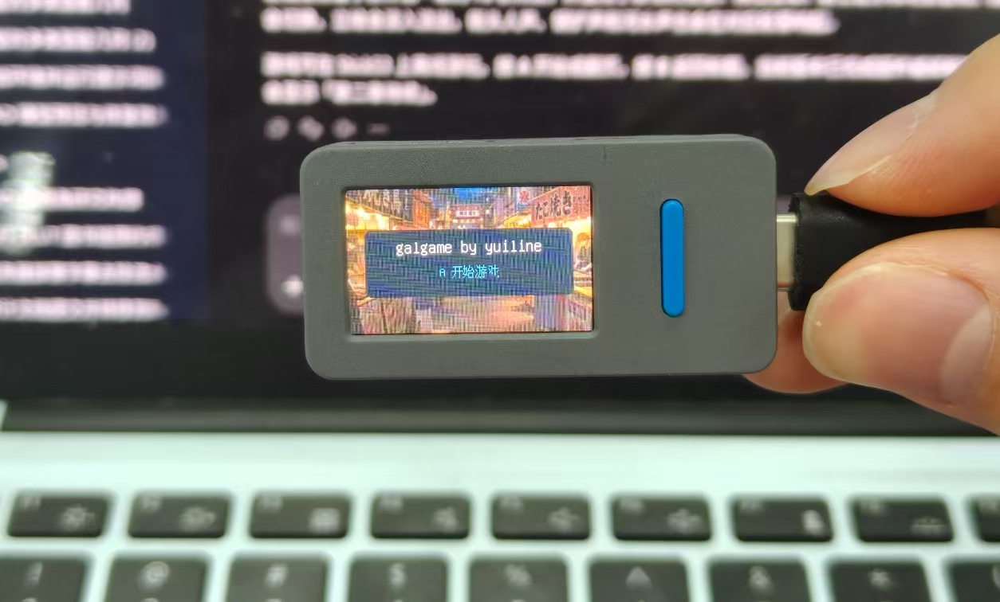
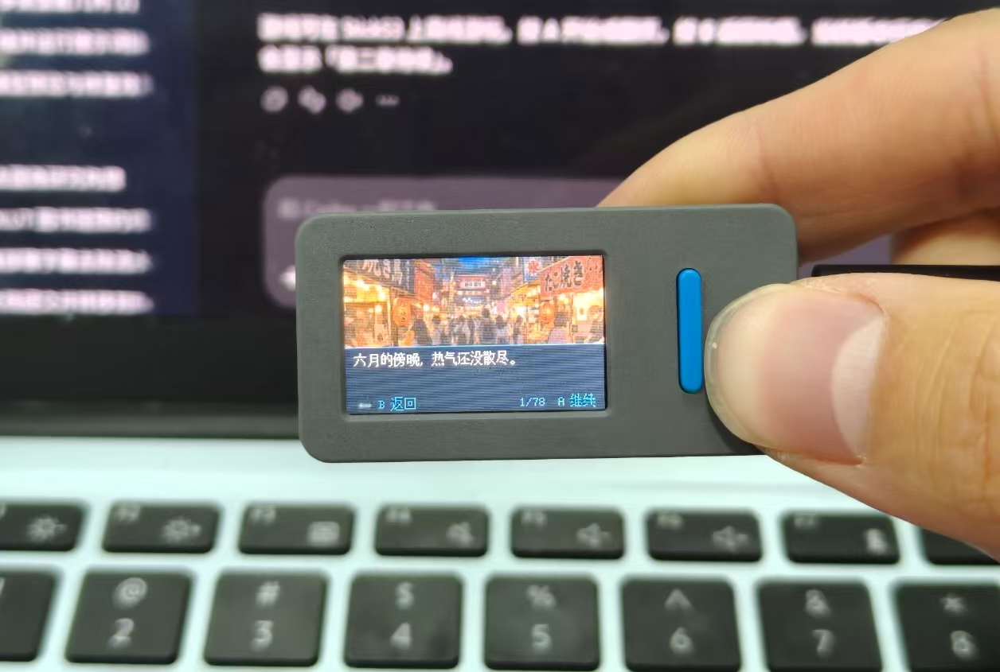

# StickS3 视觉小说

在 M5Stack StickS3 的 240 × 135 横屏上游玩中文视觉小说。两套固件可以分别刷入同一块开发板，通过 A、B 两个按键操作。

| 固件 | 内容 |
| --- | --- |
| `YuilineStory` | Yuiline 网页视觉小说第一章的移植，共 78 页，含立绘、背景、配乐和环境音。第一章可离线游玩，章末可通过 USB 连接电脑，由 DeepSeek 按玩家选项续写。 |
| `StickStory` | 「丛雨摸头」同人小游戏，带好感度、分支结局、自动存档和彩蛋。默认使用程序绘制的画面与合成提示音，可导入本地图片和音频。 |

## 真机实拍

以下三张照片展示 Yuiline 版在 StickS3 上的运行画面。

| 标题页 | 第一章开场 | 剧情对话 |
| :---: | :---: | :---: |
|  |  |  |

## 编译与刷写

需要 StickS3、USB 数据线、Windows PowerShell，以及已加入 `PATH` 的 Arduino CLI。第一次使用时安装 ESP32 板卡支持和显示库。

```powershell
$esp32Index = 'https://espressif.github.io/arduino-esp32/package_esp32_index.json'
arduino-cli core update-index --additional-urls $esp32Index
arduino-cli core install esp32:esp32@3.3.10 --additional-urls $esp32Index
arduino-cli lib install 'M5Unified@0.3.0' 'M5GFX@0.3.0'
```

在仓库根目录执行下列命令。把 `COM6` 换成 `Ports` 列出的实际串口。刷写会覆盖板上的现有固件。

```powershell
.\arduino.ps1 -Action Ports
.\arduino.ps1 -Action Compile -Sketch StickStory
.\arduino.ps1 -Action Upload -Sketch StickStory -Port COM6
```

编译 Yuiline 版前，先按[素材导入指南](docs/yuiline.md)生成 `Generated.cpp`，再将上述编译和刷写命令中的 `StickStory` 换为 `YuilineStory`。编译产物位于 `.build/<固件名>/`。脚本也支持通过 `-ToolchainRoot` 复用现有的便携式 Arduino CLI 工具链，例如原开发环境中的同级 `dafeiyu4esp32`。

## 操作指南

### 丛雨摸头

- 标题页按 **A** 开始，已有存档时按 **B** 继续。
- 故事中点按 **A** 补全对白或切换选项，只有一个选项时可直接继续。点按 **B** 确认当前选项。
- 长按 **A** 返回标题，长按 **B** 触发彩蛋。好感度从 50 开始，选择会改变好感度和剧情走向。
- 如需自定义图片和音频，安装 Pillow 后运行 `python tools/make_assets.py <本地素材目录>`。文件命名规则可在[素材脚本](tools/make_assets.py)开头查看。

### Yuiline

标题页按 **A** 开始第一章，按 **B** 直接进入续写。第一章按 **A** 翻页、按 **B** 返回标题。续写的按键、电脑端配置和模型调用方式见 [Yuiline 使用指南](docs/yuiline.md)。

## 项目结构

```text
firmware/
  StickStory/      同人小游戏固件与分支逻辑
  YuilineStory/    第一章播放器、音频时间轴与串口续写逻辑
host/              电脑端续写服务和 Python 依赖
tools/             本地素材导入脚本
docs/              Yuiline 使用指南与设备实拍
arduino.ps1        串口查询、编译与刷写入口
```

Yuiline 版的第一章剧情、图片与音频来自原网页项目。实拍展示移植效果，固件所需的上游素材由导入脚本在本地生成。 [Yuiline 原项目](https://github.com/Yuiline/galgame-by-yuiline/tree/768123ba8fe67dc72fac3fa9b420a9e514b45d08)
